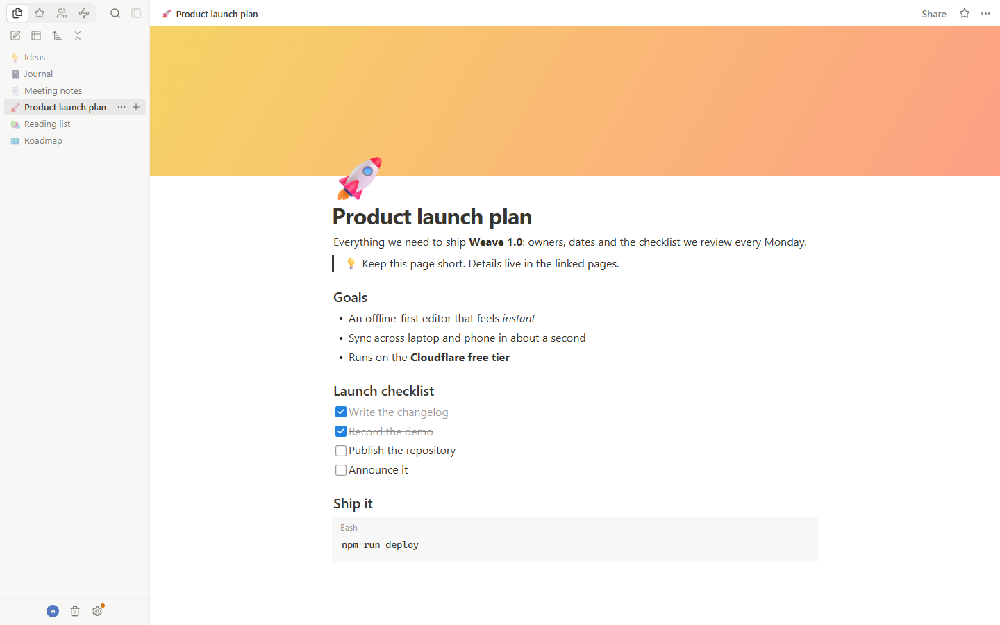
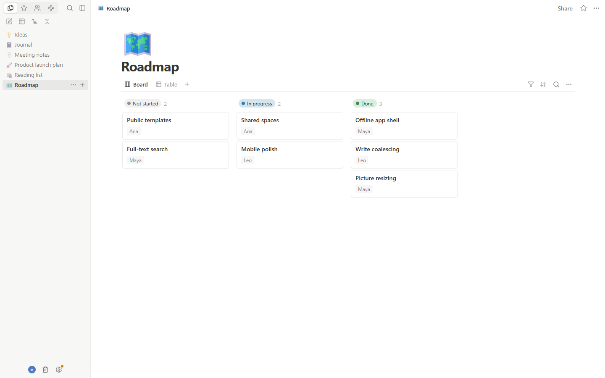
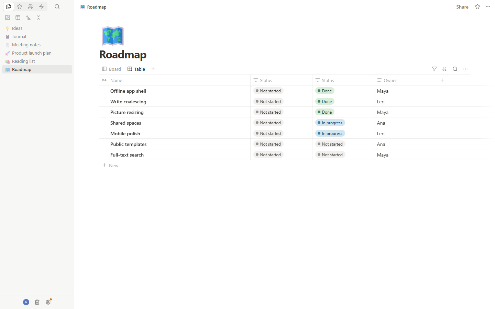
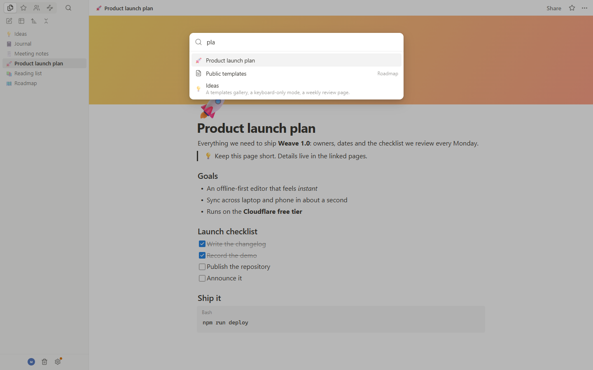
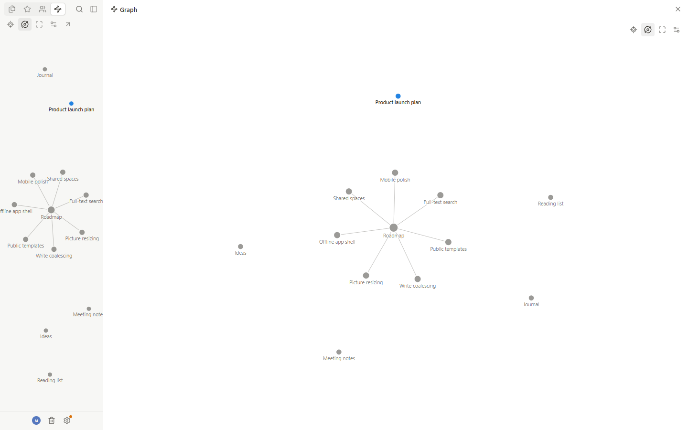
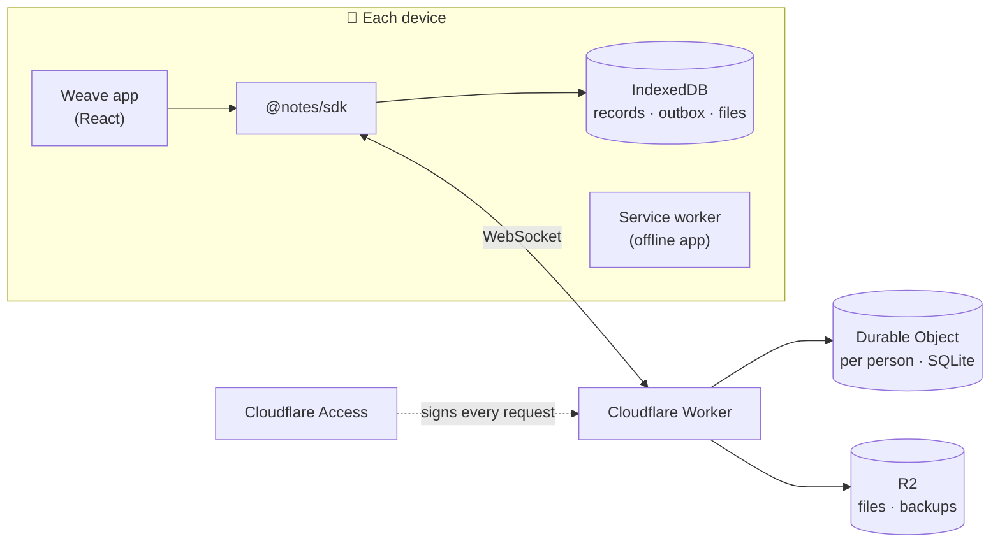

<p align="center">
  
</p>

<div align="center">


**Pages, blocks and databases that work offline, sync across your devices, and run on your own Cloudflare account.**

A fast, keyboard-first writing workspace. It saves every keystroke on your device first and keeps your laptop and phone in step through a tiny server you host yourself, for free.

[Features](#-features) · [Quick start](#-quick-start) · [Self-host on Cloudflare](#-self-host-on-cloudflare) · [How it works](#-how-it-works) · [Changelog](CHANGELOG.md)

</div>

<p align="center">
  <picture>
    <source media="(prefers-color-scheme: dark)" srcset=".github/assets/screenshots/editor-dark.png" />
    
  </picture>
</p>

## Why Weave

Most note apps make you choose between **fast and private** (local files,
no sync) and **synced** (someone else's cloud, a subscription, and a
spinner when the Wi-Fi drops). Weave gives you both:

- ⚡ **Instant:** every edit is saved in the browser the moment you make it.
- ✈️ **Offline:** it opens and works with no network, then catches up by
  itself.
- 🔄 **Synced:** edits reach your other devices in about a second, and two
  devices editing the same paragraph both keep their words.
- 🔐 **Yours:** it runs in your own Cloudflare account behind your own
  sign-in, with nightly backups, at $0 a month.

## ✨ Features

<table>
  <tr>
    <td width="50%"></td>
    <td width="50%"></td>
  </tr>
  <tr>
    <td align="center"><b>Boards</b>, grouped by status</td>
    <td align="center"><b>Tables</b>, with sorting and filters</td>
  </tr>
  <tr>
    <td width="50%"></td>
    <td width="50%"></td>
  </tr>
  <tr>
    <td align="center"><b>Quick Find</b> across every page</td>
    <td align="center"><b>Graph view</b> of your knowledge</td>
  </tr>
</table>

### ✍️ Writing
- **Rich blocks:** text, headings, to-dos, bulleted and numbered lists,
  quotes, callouts, dividers, code with syntax highlighting, tables,
  images, files and embeds (YouTube, X and links).
- **Markdown as you type:** `#`, `-`, `1.`, `[]`, `>`, ```` ``` ````,
  `**bold**`, `` `code` ``, plus a formatting toolbar with colours and links.
- **Linked thinking:** mention pages and dates, and see backlinks on every
  page.
- **Arrange freely:** drag and drop, move between pages, group, fold and
  duplicate blocks.
- **Make it yours:** covers, emoji or picture icons, page fonts, light and
  dark themes.
- **Never lose a word:** undo and redo, page history with restore, and a
  trash.

### 🗂️ Databases
- Full-page and inline databases.
- **Table, Board, List, Gallery and Calendar** views.
- Text, select, status, date, person and image properties.
- Open any row as a page in a side peek.

### 📱 Everywhere
- Install it as an app on desktop and mobile.
- Reload it with no network and keep working.
- Pictures are resized on your device before upload, so storage lasts for
  years.

### 💾 Your data
- **Export** everything to one file and **Import** it back, merging or
  replacing.
- **Nightly backups** to your own storage (30 kept) and **point-in-time
  restore** for the last 30 days.

### 👥 Sharing (optional)
- Shared spaces with roles (owner, full access, editor, viewer) and live
  presence. Off by default; see [Sharing](#-sharing).

## 🎯 Who it's for

- People who want a **Notion-style workspace** without a subscription or
  someone else's cloud.
- Writers and engineers who work **on the go** and hate sync spinners.
- Developers who like to **self-host** and want something that fits the
  Cloudflare free tier.
- Small teams of up to about 50 people who want one private shared
  workspace.

## 🚀 Quick start

Try it on your machine in local mode. No account or server is needed;
everything stays in your browser.

```sh
git clone https://github.com/tuanntq99/weave.git
cd weave
npm install
npm run dev
```

Open the address Vite prints. You need **Node.js 24** or later.

> [!TIP]
> Local mode can stand in for several people. Open
> `http://localhost:5173/?as=ada` in one tab and `?as=grace` in another,
> share a page, and watch edits, cursors and presence move between them.

## ☁️ Self-host on Cloudflare

Weave runs on Cloudflare's **free plan**: Workers, Durable Objects, R2 and
Zero Trust Access (up to 50 people). You sign in with a **one-time code
sent to your email**, with no passwords. Setup takes about 20 minutes.

> [!TIP]
> 📘 **[Read the step-by-step guide](docs/self-hosting.md)**. It covers
> where every setting lives in the dashboard, how to add more people,
> updating, and troubleshooting. Below is the short version.

**1. Get the code and sign in to Cloudflare**

```sh
git clone https://github.com/tuanntq99/weave.git && cd weave
npm install
npx wrangler login
```

**2. Prepare your account.** In the dashboard, open **Workers & Pages** and
pick a `workers.dev` subdomain (new accounts are asked once). Then turn on
**R2** and create the bucket:

```sh
npx wrangler r2 bucket create notes-files
```

**3. Deploy**

```sh
npm run deploy
```

Weave is now at `https://notes.<your-subdomain>.workers.dev`. Nobody can
sign in until the next steps are done.

**4. Set up sign-in with Cloudflare Access**

| | Where | What to do |
|---|---|---|
| a | **Zero Trust** (first visit) | Choose a **team name** and the **Free** plan |
| b | Zero Trust → **Settings → Authentication** | Under *Login methods*, **Add new → One-time PIN** |
| c | Workers & Pages → **notes → Settings → Domains & Routes** | On the `workers.dev` row, turn on **Cloudflare Access** |
| d | Zero Trust → **Access → Applications** → your app → **Policies** | **Allow**, Include → selector **`Emails`** → your email address |
| e | Same application → overview | Copy the **Application Audience (AUD) Tag** |

> [!WARNING]
> Use the selector **`Emails`** with your full address, not
> *Emails ending in*. With the wrong one no code is ever sent.

**5. Give the server its settings.** They are stored as Cloudflare secrets,
never in the repository, and take effect at once:

```sh
npx wrangler secret put ACCESS_TEAM -c server/wrangler.jsonc   # the team name only, e.g. maya-notes
npx wrangler secret put ACCESS_AUD  -c server/wrangler.jsonc   # the AUD tag from step 4e
npx wrangler secret put OWNER_EMAIL -c server/wrangler.jsonc   # your email (may restore backups)
```

**6. Sign in.** Open your Weave address, enter your email, type the 6-digit
code Cloudflare emails you, and start writing. 🎉

> [!NOTE]
> If you tried local mode first, choose *Data → Export* there and
> *Data → Import* on your new deployment to bring your pages over.

<details>
<summary><b>Deploy from GitHub Actions</b></summary>
<br>

Add the repository secrets `CLOUDFLARE_API_TOKEN` (permissions: Workers
Scripts and Workers R2 Storage, edit) and `CLOUDFLARE_ACCOUNT_ID`. The
workflow in `.github/workflows/deploy.yml` then builds, tests and deploys
whenever a version tag (`v1.2.3`) is pushed. Without the secrets it does
nothing.

</details>

<details>
<summary><b>Run the server locally</b></summary>
<br>

```sh
npm run build
npx wrangler dev -c server/wrangler.jsonc --var DEV_USER:ada
```

`DEV_USER` signs you in as `ada` on `localhost` only. It is ignored
anywhere else.

</details>

<details>
<summary><b>What it costs on the free plan</b></summary>
<br>

For a few people writing every day, Weave uses a small slice of the free
allowances. Typing is batched into one write per pause, and each write
costs about three database rows. The most used limit, Durable Object rows
written, stays at around 5–10% of the daily allowance.

</details>

## 💾 Backups and restore

| | |
|---|---|
| **Nightly backups** | At 03:00 UTC each person's data is written to R2 (`backups/<scope>/<date>.json`) in the same format as *Export*. The last 30 are kept. To go back to a day, download its file and *Import* it. |
| **Point-in-time restore** | Durable Objects keep 30 days of history. The owner can roll a person's data back to any moment: `POST /api/admin/restore` with `{"scope": "personal:<user id>", "at": <ms since epoch>}`. The answer includes an `undo` bookmark. |
| **Clear a device** | The *Data* menu removes this browser's copy. It refuses while changes are still waiting to be sent, and everything is downloaded again on the next visit. |

## 👥 Sharing

Sharing is built in but **off by default**: Weave starts as one person's
workspace. To share spaces with others:

1. Add their emails to your Access application's policy.
2. Ask each of them to open Weave and sign in once, so they can be found.
3. Turn sharing on and deploy:

   ```sh
   npx wrangler secret put SHARING -c server/wrangler.jsonc   # enter: on
   npm run deploy
   ```

4. Create a space and invite people by email. Viewers can read but not
   change.

Delete the `SHARING` secret to turn sharing off again. Spaces are hidden,
and their data stays on the server.

## 🧠 How it works



- **Local first:** the app reads and writes the browser's copy. A write
  shows at once and waits in a durable outbox until the server confirms
  it, so a closed tab or a dropped connection loses nothing.
- **One object per person:** each person's records live in their own
  Durable Object, which numbers every change and pushes it to their other
  devices. Idle sockets hibernate, so quiet hours cost nothing.
- **Merging:** rich text merges character by character. Other fields merge
  field by field, and the later change wins.

## 🛠️ Tech stack

| | |
|---|---|
| **App** | React 19 · TypeScript · Vite |
| **Client SDK** | `@notes/sdk`: IndexedDB, durable outbox, WebSocket sync, cross-tab updates |
| **Protocol** | `@notes/sync-protocol`: shared by client and server, three-way text merge |
| **Server** | Cloudflare Workers · Durable Objects (SQLite, hibernation) · R2 · Cron |
| **Sign-in** | Cloudflare Access (JWT verified on every request) |
| **Quality** | 199 unit and server tests (Vitest, the Workers runtime) and end-to-end browser tests |

## 🧑‍💻 Development

```sh
npm run dev          # the app in local mode
npm test             # unit tests
npm run test:server  # server tests, on the Workers runtime
npm run typecheck    # TypeScript, app and server
npm run e2e          # browser tests (Microsoft Edge, or NOTES_E2E_CHANNEL=chrome)
npm run build        # typecheck and production build
```

```
src/                     the app
packages/notes-sdk/      the client SDK
packages/sync-protocol/  messages, validation and merging shared with the server
server/                  the Cloudflare Worker and Durable Objects
e2e/                     end-to-end tests
```

## ⭐ Support

If Weave is useful to you, a star helps other people find it.

<p align="center">
  <a href="https://github.com/tuanntq99/weave/stargazers">
    
  </a>
</p>

## 📄 License

[MIT](LICENSE) © Weave contributors
